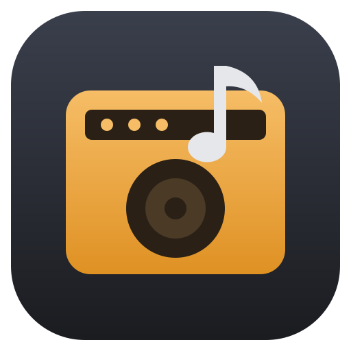

# Basement Band

A simple, GarageBand-style music studio for Windows and Linux. It ships with a full band of
instruments, a drummer that writes its own parts, a loop library and a sample browser, so you can
open it and start making music.



## What's inside

- **Session Band**: pick a style (Pop, Rock, Funk, Lo-Fi, Jazz Trio, House, Ballad, Reggae, Country,
  Synthwave) and a chord progression, and it writes drums, bass, keys, guitar, pads and arps. Every
  part is an ordinary track you can edit, re-voice or re-roll.
- **Time signatures**: 2/4, 3/4, 4/4, 5/4, 6/8, 7/8, 9/8 and 12/8. Every band style adapts its
  grooves to the meter, and the metronome, count-in, ruler and editors follow it. Changing the
  meter keeps regions on their bars and rewrites band parts to fit.
- **Drummer**: a drum track you steer with a Simple↔Complex / Soft↔Loud pad, with automatic fills.
- **40 instruments**: a Salamander grand piano, electric and upright bass, acoustic, nylon, clean and
  crunch guitars, a string section, brass, woodwinds, harp, mallets, organs and synths.
  There are 4 drum kits: acoustic rock (5 velocity layers), lo-fi, 808 and electro.
- **My Instruments**: import SoundFonts (.sf2), SFZ instruments, or a folder of samples (named by
  note, like `C4.wav`, or drum hits like `kick.wav`). Every SoundFont preset (including GM drum kits
  in bank 128) becomes an instrument. Drag .sf2/.sfz files onto the window to add them.
- **Loops**: about 80 MIDI loops. They follow your song's key and tempo, like Apple Loops.
- **Samples**: tempo-synced generated FX (risers, downlifters, reverse cymbals, sweeps, impacts,
  sub drops), 45 CC0 recordings (waves, wind, rain and thunder, birds, streams, crowds, fire, vinyl
  crackle, city ambience, whooshes, booms, drones), drum one-shots, plus any folders of
  WAV/MP3/FLAC/OGG files you add. Drag
  them onto the timeline, or drop audio files in from your file manager.
- **Arranging audio**: drag an audio clip's bottom-right corner to extend it with silence (e.g. to
  fill whole bars) and its top-right corner to repeat it; clips snap to the grid when moved.
- **Recording**: record your mic or audio interface onto audio tracks (pick the device and input
  1, 2 or both; latency compensation; count-in), or record MIDI keyboards and Musical Typing onto
  instrument tracks.
- **Guitar & bass**: a "Guitar / Bass" track with an amp sim (Clean, Crunch, Lead, Bass: gain,
  tone stack, presence, noise gate, speaker cabinet). Monitor through it while you play; recordings
  stay clean (DI), so you can change the amp afterwards. Monitoring latency depends on your OS audio
  (shown in the app; ~24 ms on Linux/PipeWire with Low-latency mode).
- **Editing**: piano roll, drum grid, region loop/resize/split/duplicate, undo/redo.
- **Mixing**: per-track volume, pan, tone, drive, reverb, echo and a Bass/Mid/Treble EQ; master
  bus compressor/limiter.
- **Effects**: Vinyl (crackle, pops, age, wow), Tape, Radio and Lo-Fi, on any track or on the whole
  mix (Master FX). Crackle and hiss only play while the song does.
- **Export**: the whole song or the cycle range as MP3 (128/192/320 kbps), FLAC, or 16/24-bit WAV.

## Run it

```sh
npm install        # also downloads the ~78 MB sample library into assets/samples/
npm start
```

If the samples didn't download (offline install), run `npm run fetch-samples` later. Until then,
sampled instruments fall back to built-in synths.

## Your own instruments

Sounds → **My Instruments** → **＋ SF2 / SFZ…** or **＋ Folder…** (or drop files on the window).

- **SoundFont 2**: all presets, key/velocity zones, loops, volume and filter envelopes, tuning,
  exclusive classes (hi-hat choke). Compressed .sf3 files are not supported yet.
- **SFZ**: `#define`/`#include`, `<global>/<master>/<group>/<region>`, velocity layers and curves,
  loops (including loop points embedded in WAV/FLAC), round-robin and random layers, release
  triggers, choke groups, filters with envelopes, keyswitches, and CC-driven opcodes evaluated at
  their `set_ccN` defaults. Samples load fully into memory, so multi-gigabyte libraries need
  plenty of RAM.
- Songs store references to the files, not the samples. On another machine, re-import the same
  files; until then the tracks play a stand-in synth.

The engine is built around *instrument sources* (`src/engine/user-instruments.js`), so a native
VST3/CLAP plugin host could be added later as another source kind.

## Build installers

```sh
npm run dist:linux   # dist/Basement Band-<version>-linux-x86_64.AppImage and .deb
npm run dist:win     # dist/Basement Band-Setup-<version>.exe and -Portable-<version>.exe
```

Windows builds can be made on Linux if `wine` is installed. Installers bundle the sample library,
so the app works offline.

## Releases

Publishing a GitHub release builds the app and attaches the installers to it
(`.github/workflows/release.yml`):

1. Create a release with a version tag such as `v0.2.0` (the app version is taken from the tag).
2. Publish it. The **Release** workflow builds the Linux AppImage and `.deb` and the Windows
   installer and portable `.exe`, and uploads them to that release (about 15 minutes).

To rebuild artifacts for an existing release, run the workflow manually from the Actions tab and
enter its tag. Every push and pull request also runs the unit tests (`.github/workflows/ci.yml`).
Builds are unsigned, so Windows SmartScreen will warn on first launch.

## Current limitations

- **Latency:** audio runs through Chromium's Web Audio, so there's no ASIO/JACK-level low latency.
  Measured guitar monitoring on Linux/PipeWire: ~60 ms by default, ~24 ms with **Low-latency mode**
  (Input section; smallest Chromium buffers, and PipeWire's quantum lowered to 128 frames while
  monitoring). Getting below ~10 ms needs a native audio path (see the roadmap). Until then, your
  interface's hardware direct monitoring gives zero-latency (dry) monitoring while recording.
- **One time signature and tempo per song:** no tempo or meter changes partway through.
- **Audio doesn't follow tempo changes:** recordings and samples keep their speed and length.
- **No automation:** volume, pan and effect settings are fixed for the whole song.
- **Songs embed recordings as WAV inside the `.bband` file**, so songs with long takes get large.
- **User instruments are referenced, not copied:** move a SoundFont/SFZ and songs using it fall back
  to a stand-in synth until it is re-imported.
- **SoundFont/SFZ:** no `.sf3` (compressed) files; MIDI controllers (mod wheel, sustain pedal) don't
  change sounds yet; large libraries load fully into memory.
- **MIDI files:** can't import or export `.mid` yet.
- **The Freesound recordings are high-quality previews** (128 kbps MP3), not the original WAVs.
- **macOS isn't built or tested** (Electron supports it; it needs a Mac runner and signing).
- **Windows builds are tested only under Wine** in development, not on real Windows hardware.

## Roadmap

Roughly in priority order:

1. **Automation lanes** for volume, pan, EQ and effects.
2. **Sustain pedal and MIDI CC** support for SoundFont/SFZ instruments and recording.
3. **MIDI file import/export.**
4. **Tempo-following audio** (time-stretching loops and recordings).
5. **Tempo and time-signature changes** within a song.
6. **Song files with audio stored alongside** (or compressed) instead of embedded WAV.
7. **Native low-latency audio helper** (JACK/PipeWire on Linux, ASIO/WASAPI exclusive on Windows)
   running the amp sim for sub-10 ms guitar monitoring; the same helper would host
   **VST3/CLAP plugins** as a new instrument source.
8. **More amp and cabinet models**, plus impulse-response loading for cabinets.
9. **macOS builds** and code signing on all platforms.
10. **Arrangement markers** (verse/chorus) and a song-structure view for the Session Band.

## Keyboard shortcuts

| Key | Action |
|---|---|
| Space | Play / stop |
| R | Record |
| Enter | Go to start (or cycle start) |
| C | Cycle on/off |
| K | Metronome |
| Ctrl+K | Musical Typing (A–' play notes, Z/X octave, C/V velocity) |
| Y / B / E | Library / Smart Controls / Editor |
| Ctrl+D | Duplicate region |
| Ctrl+T | Split region at playhead |
| Delete | Delete regions or selected notes |
| Ctrl+Z / Ctrl+Shift+Z | Undo / redo |
| Ctrl+S / Ctrl+O / Ctrl+N | Save / open / new |
| Ctrl+E | Export (MP3, FLAC or WAV) |
| Ctrl+scroll | Zoom timeline or editor |
| Alt-drag region | Copy region |
| Region top-right corner | Drag to loop; bottom-right corner resizes |

## Project layout

```
main.js, preload.js         Electron shell (app:// protocol, file dialogs, settings)
src/app.js                  controller: transport, recording, files, shortcuts
src/state.js                song model and undo store
src/music/theory.js         notes, chords, roman numerals, voicings
src/music/band.js           styles + drum/bass/comping generators
src/engine/instruments.js   instrument library (samplers, synth presets, drum kits)
src/engine/engine.js        mixer graph, scheduling, recording, offline export
src/ui/*                    arrange view, editors, smart controls, library
scripts/fetch-samples.mjs   downloads the sample library
test/                       unit tests and headless end-to-end checks
```

## Tests

```sh
npm test         # music theory and generator unit tests
npm run smoke    # end-to-end flows in a hidden app window (Linux, needs xvfb-run; forces X11 so
                 # nothing opens on a Wayland desktop)
npm run levels   # renders every instrument and prints its loudness
npm run test:instruments   # SoundFont/SFZ/folder import + playback checks (uses FluidR3_GM.sf2
                           # if installed; set BB_SFZ_TEST_DIR to a folder of SFZ libraries)
```

## Licenses

The code is MIT licensed. MP3 export uses LAME via `@breezystack/lamejs` (LGPL-3.0), shipped as a
separate, replaceable file. The sample library is not covered by MIT. It comes from the Salamander
Grand Piano, VSCO 2 Community Edition, Karoryfer, University of Iowa MIS and Freesound (CC-BY 3.0),
plus the Hydrogen drum kits (GPL). See `assets/samples/CREDITS.md`, which the app also opens from
Library → Sounds → Credits.
